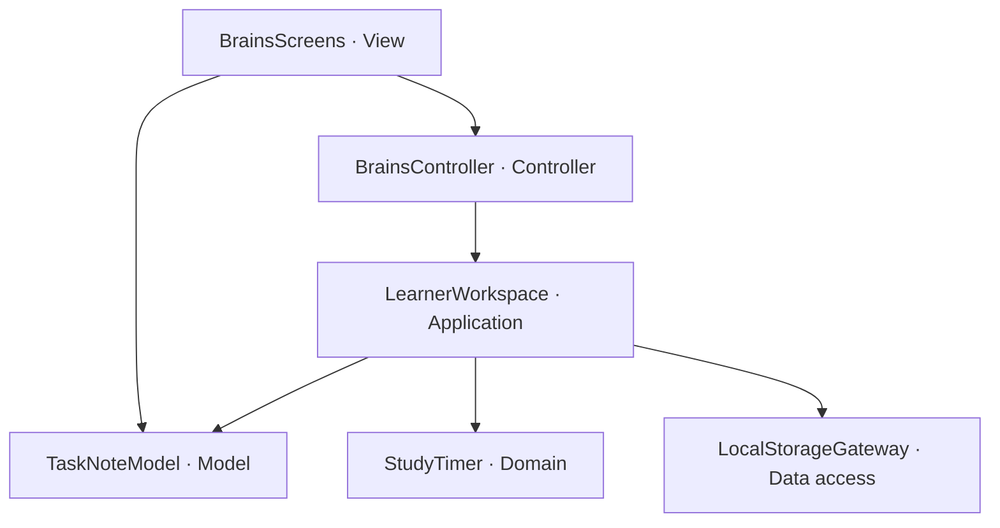

# Brains architecture

Brains uses layered architecture with MVC and relaxed layering. It runs as a single-user browser application on one device. Vite serves static ES modules in development and emits static production files; there is no application backend, login service, or remote database.

## Components and ownership

| Component | Layer / role | Responsibility | Domain class ownership |
| --- | --- | --- | --- |
| BrainsScreens | Presentation / View | Renders model snapshots, dashboard, forms, note text, tag filters, timer, validation and status feedback; forwards user actions | None |
| BrainsController | Presentation / Controller | Parses FormData and events, holds temporary navigation/filter/draft state, calls LearnerWorkspace, requests rendering | None |
| LearnerWorkspace | Application | Coordinates operations, load/save, record reconstruction, transaction boundaries, and timer actions | LearnerProfile |
| TaskNoteModel | Domain / Model | Task/note/tag validity, completion, due sorting, overdue checks, shared tag identity, OR matching | TaskList, Task, Note, Tag |
| StudyTimer | Domain | Work/break duration, elapsed time, transitions, start/pause/resume/reset | PomodoroTimer |
| LocalStorageGateway | Data access | Read/write versioned plain JSON in localStorage and translate storage errors | None |

Each class is defined once, in its owning component. Presentation classes named `BrainsScreens` and `BrainsController` are adapters, not domain classes. There are no circular module imports; an automated architecture test checks the import graph and six component directories.

## Allowed dependencies



These are allowed directions, not a requirement that every possible arrow be imported. Screens currently receive plain view snapshots and an injected controller; they need no direct model import. The controller receives an injected workspace and rendering port. Calling back to that supplied view port coordinates presentation without importing a presentation module into the application/domain. Returns and error results do not add an upper-layer dependency. Bootstrap in `src/main.js` creates and connects the adapters.

Relaxed layering lets the application call data access directly without forcing domain objects to know storage. A View may read domain data for display, while all user operations pass through the Controller and application. Business validation lives in domain classes, rather than event handlers. LearnerProfile enforces application-level coordination such as resolving reusable tags and committing a whole operation.

## Adding a task

1. BrainsScreens renders a labeled form and forwards its submission.
2. BrainsController parses title, calendar-date string, description, and selected tag IDs, then calls `LearnerProfile.submitTask`.
3. LearnerProfile builds a temporary candidate from the current valid records, resolves selected IDs to shared Tag objects, and calls `TaskList.addTask`.
4. Task validates the title and due date. Domain validation throws before any write if input is invalid.
5. LearnerProfile serializes the candidate; LocalStorageGateway writes the versioned record with one `setItem`.
6. Only after saving succeeds does LearnerProfile replace its current state. The Controller requests a new view snapshot and success feedback. On failure, the previous state remains; the View shows the error and retains the draft.

StudyTimer does not participate in adding a task. It operates independently, with timer actions coordinated through the same Controller → LearnerWorkspace path.

## Loading and saving

`LocalStorageGateway.load()` reads `brains.workspace` once and parses `{ version: 1, workspace: ... }`. It imports no domain, screen, or controller classes. It returns plain records, never instantiated domain objects.

LearnerProfile reconstructs Tags first, then resolves task/note `tagIds` to those same instances. It validates required fields, globally unique IDs, normalized tag names, valid dates, completion booleans, and existing tag references. Invalid records are not silently dropped or reset. A failed load records a blocking error and prevents mutations. The original saved value remains untouched. An empty workspace is used only if the key is absent, or as a display fallback accompanied by a blocking load warning.

All changes use the same transaction path: reconstruct a candidate, validate/change it, serialize, call the gateway once, then adopt it. A candidate is a short-lived transaction object, not a second competing app state. `getSnapshot` produces detached presentation records; filters never write. Browser localStorage's individual `setItem` operation either succeeds or throws; it does not partially update the existing key. No success message is produced for a failed mutation.

```json
{
  "version": 1,
  "workspace": {
    "name": "Learner",
    "tags": [{ "id": "tag-id", "name": "CS 2450" }],
    "tasks": [{ "id": "task-id", "title": "Read chapter", "dueDate": "2026-11-05", "description": "", "isComplete": false, "tagIds": ["tag-id"] }],
    "notes": [{ "id": "note-id", "title": "Lecture", "courseName": "CS 2450", "content": "Text", "lastEdited": "2026-11-05T17:00:00.000Z", "tagIds": ["tag-id"] }]
  }
}
```

This example documents the schema; it is not seeded into the app. IDs are UUIDs when created normally. `dueDate` remains `YYYY-MM-DD`; sorting compares those strings, stable ties keep saved insertion order, and display uses local noon rather than interpreting UTC midnight. `lastEdited` is a timestamp rather than a calendar date and is displayed in the browser's local timezone.

## Timer

PomodoroTimer accepts an injectable clock. Start/resume sets a deadline from the remaining duration; pause samples elapsed time. Each state read compares the current clock to the deadline. Missed full cycles are skipped arithmetically, followed by at most two boundary transitions. Work and break alternate automatically. A 250 ms presentation callback only refreshes the display; it never decrements the timer. Navigating between app views retains the same timer. Reloading resets it to a stopped 25-minute work session.

## Deployment, performance, and limits

The browser and local file server run on the same device over loopback. Runtime assets require no internet, fonts or third-party service. Browser storage is isolated per origin and profile. One tab at a time is supported; no cross-tab merge or coordination is claimed. Data is local, not encrypted or automatically backed up. No network service is needed for core features.

One storage read loads all tasks; sorting happens in memory. Navigation/filter changes replace the current main view rather than the entire page. Completing a task patches only that row's completion presentation and overview counts, retaining its checkbox and focus. Timer updates affect only timer elements and never save workspace records. The actual 200-task, 20-run measurements and their environment limitations are in `performance-results.json` and `verification.md`.
