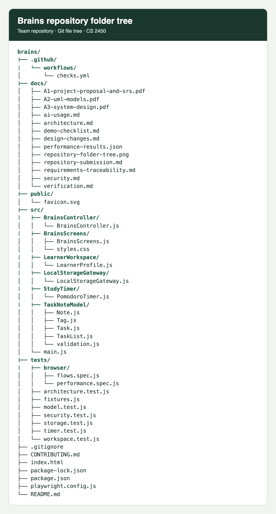

# Repository

**CS 2450 Software Engineering · Brains · Repository section (20 points)**

**Team:** Mateo Osorio Delhonte and Priscilla Gyllenskog

**Section owner:** Mateo Osorio Delhonte

[Team repository on GitHub](https://github.com/mateoosoriodelhonte/brains) · [Exact setup steps](../README.md#run-locally-from-a-fresh-checkout) · [Tracked `.gitignore`](../.gitignore)

## Folder tree

The screenshot shows the repository's tracked tree. The six component folders use the names and class ownership in A3 §3.3, Figure 4. They share the `src/` directory with the application entry point. `docs/` contains the original A1–A3 PDFs.

| Component under `src/` | Implementation owner in A3 | A2 domain classes |
| --- | --- | --- |
| `BrainsScreens` | Mateo | None |
| `BrainsController` | Mateo | None |
| `LearnerWorkspace` | Priscilla | `LearnerProfile` |
| `TaskNoteModel` | Priscilla | `TaskList`, `Task`, `Note`, `Tag` |
| `StudyTimer` | Mateo | `PomodoroTimer` |
| `LocalStorageGateway` | Priscilla | None |

## Assignment documents

- [A1 — Project proposal and SRS draft](A1-project-proposal-and-srs.pdf)
- [A2 — UML models](A2-uml-models.pdf)
- [A3 — System design](A3-system-design.pdf)

The shared `.gitignore` excludes `.env` files, installed dependencies, builds, browser test output, and personal backups. The application stores its data in the browser and needs no credentials or `.env` file to start. GitHub access to the private repository is separate from using Brains.

The team’s [AI assistance log](ai-usage.md) records the use of Codex to prepare the repository materials and update and test the code.
